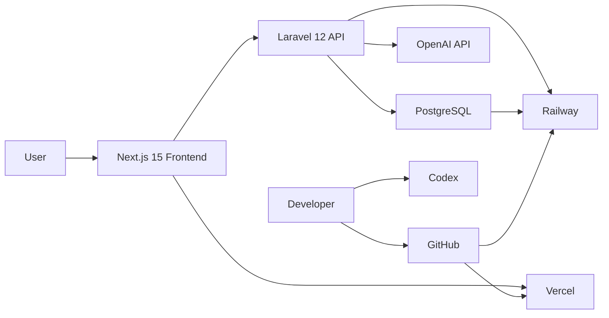
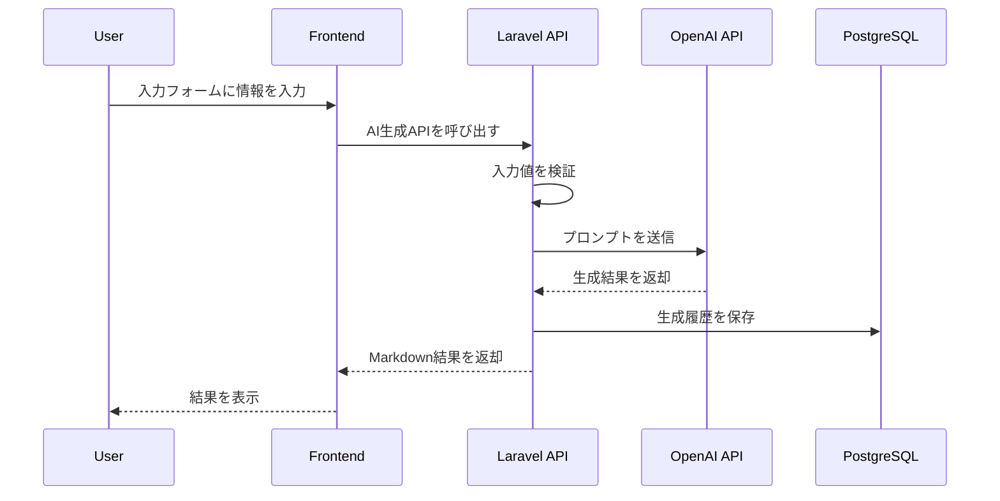
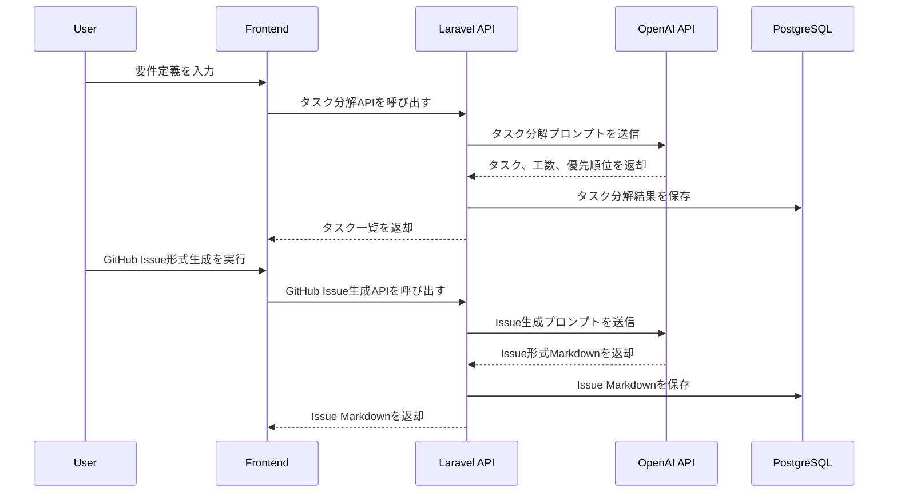

# Architecture

## Application Design Policy

本プロジェクトでは、MVP段階では Laravel の MVC 構成を基本とし、Controller / Form Request / Service / Model の責務分離を優先する。

現時点では DDD を全面採用しない。理由は、まだ複雑な業務ルール、複数集約、課金、権限、ワークスペース、履歴管理などのドメイン境界が十分に固まっていないため。

ただし、将来的な SaaS 化や機能拡張に備えて、DDD へ移行しやすい構成を意識する。

基本方針:

* Controller に業務ロジックを書かない
* 入力検証は Form Request に分離する
* AI生成や外部API連携は Service クラスに分離する
* 保存処理が増えたら Repository / UseCase の導入を検討する
* 課金、ユーザー管理、ワークスペース管理、履歴管理が複雑化した段階で Domain / Application / Infrastructure の分離を検討する
* DDD は最初から大きく導入せず、必要になった領域から段階的に採用する

将来的な移行イメージ:

```text
backend/app/
├─ Domain/
│  └─ AiGeneration/
├─ Application/
│  └─ AiGeneration/
├─ Infrastructure/
│  └─ OpenAI/
└─ Http/
   ├─ Controllers/
   └─ Requests/
```

# AI Cost Optimization Architecture

本システムでは将来的なAI利用料増加に備え、以下の設計方針を採用する。

* Frontend から直接AI APIを呼ばない
* Laravel Backend経由でAI APIを利用する
* AI処理は Serviceクラスへ集約する
* モデル名は環境変数で切り替え可能にする
* 機能ごとに利用モデルを変更できる構成にする
* 入力文字数制限を設ける
* 出力トークン上限を設ける
* キャッシュ追加可能な構成にする
* レートリミット追加可能な構成にする
* 利用量ログ追加可能な構成にする

## 概要

ai-delivery-assistant は、Next.js 15、Laravel 12、PostgreSQL、OpenAI APIを中心に構成するAI開発支援プラットフォームです。

フロントエンドはVercel、バックエンドとデータベースはRailwayで運用する想定です。開発環境ではDockerを利用し、GitHubとCodexを開発ワークフローに組み込みます。

## 技術構成

| 領域 | 技術 |
| --- | --- |
| Frontend | Next.js 15, TypeScript, TailwindCSS |
| Backend | Laravel 12 |
| Database | PostgreSQL |
| AI | OpenAI API |
| Infrastructure | Vercel, Railway |
| Development | Docker, GitHub, Codex |

## 全体構成



## レイヤー構成

### Frontend

Next.js 15でユーザーインターフェースを実装します。

主な責務:

- 入力フォームの表示
- APIリクエストの送信
- AI生成結果のMarkdown表示
- 生成中、エラー、成功状態の表示
- 画面遷移

主要画面:

- ホーム画面
- AI要件定義画面
- AIタスク分解画面
- GitHub Issue生成画面
- AIレビュア画面
- AI業務改善提案画面
- 履歴画面

### Backend

Laravel 12でAPIサーバーを実装します。

主な責務:

- APIルーティング
- 入力バリデーション
- OpenAI API呼び出し
- プロンプト管理
- 生成結果の整形
- 生成履歴の保存
- エラーハンドリング

### Database

PostgreSQLで生成履歴、タスク、GitHub Issue形式Markdownなどを保存します。

主な責務:

- AI生成履歴の保存
- タスク分解結果の保存
- 工数見積と優先順位の保存
- GitHub Issue形式Markdownの保存
- 将来的なユーザー、プロジェクト、ワークスペース管理

### AI

OpenAI APIを利用して各機能の生成処理を行います。

主な生成対象:

- 要件定義Markdown
- タスク分解Markdown
- 工数見積
- 優先順位
- GitHub Issue形式Markdown
- レビューコメント
- 業務改善提案

## データフロー

### AI生成の基本フロー



### タスク分解からGitHub Issue生成までのフロー



## ディレクトリ構成案

```text
ai-delivery-assistant/
├─ frontend/
│  ├─ app/
│  ├─ components/
│  ├─ features/
│  ├─ lib/
│  └─ types/
├─ backend/
│  ├─ app/
│  │  ├─ Http/
│  │  ├─ Models/
│  │  ├─ Services/
│  │  └─ Actions/
│  ├─ database/
│  │  └─ migrations/
│  └─ routes/
│     └─ api.php
├─ docs/
└─ docker-compose.yml
```

## Backend内部構成案

Laravel側では、AI生成処理をControllerに直接書かず、ServiceまたはActionに分離します。

```text
backend/app/
├─ Http/
│  ├─ Controllers/
│  │  ├─ AiRequirementController.php
│  │  ├─ AiTaskBreakdownController.php
│  │  ├─ AiGithubIssueController.php
│  │  ├─ AiCodeReviewController.php
│  │  └─ AiBusinessImprovementController.php
│  └─ Requests/
├─ Services/
│  ├─ OpenAiService.php
│  └─ Prompt/
├─ Actions/
│  ├─ GenerateRequirementsAction.php
│  ├─ GenerateTaskBreakdownAction.php
│  ├─ GenerateGithubIssuesAction.php
│  ├─ GenerateCodeReviewAction.php
│  └─ GenerateBusinessImprovementAction.php
└─ Models/
```

## Frontend内部構成案

Next.js側では、機能単位で入力フォーム、APIクライアント、結果表示をまとめます。

```text
frontend/
├─ app/
│  ├─ requirements/
│  ├─ task-breakdown/
│  ├─ github-issues/
│  ├─ code-review/
│  └─ business-improvement/
├─ components/
│  ├─ ui/
│  └─ layout/
├─ features/
│  ├─ requirements/
│  ├─ task-breakdown/
│  ├─ github-issues/
│  ├─ code-review/
│  └─ business-improvement/
└─ lib/
   └─ api/
```

## セキュリティ方針

- 本アプリは将来的にPublicリポジトリとして公開する前提のため、APIキーや秘密情報は絶対にリポジトリへコミットしない
- OpenAI APIキーはBackend側の環境変数で管理する
- ローカル開発では `OPENAI_API_KEY` を `.env` にのみ保存する
- `.env` は `.gitignore` に含め、Git管理対象外にする
- リポジトリには `.env.example` のみ配置し、必要な環境変数名だけを記載する
- `.env.example` には実際のAPIキーや秘密情報を書かない
- FrontendからOpenAI APIを直接呼び出さず、必ずLaravel Backend API経由で呼び出す
- Laravel Backend API経由で呼び出すことで、APIキーがブラウザに露出しないようにする
- フロントエンドに秘密情報を露出しない
- 入力値はLaravel Form Requestで検証する
- ログにAPIキーや個人情報を出力しない
- 将来的に認証と認可を導入する

## デプロイ方針

### Vercel

Next.jsフロントエンドをデプロイします。

- GitHub連携で自動デプロイ
- 環境変数でLaravel API URLを管理
- Preview Deploymentsを活用

### Railway

Laravel APIとPostgreSQLをデプロイします。

- Laravel APIサービス
- PostgreSQLサービス
- 本番環境ではRailwayの環境変数に `OPENAI_API_KEY` を登録
- マイグレーション実行

### Backendホスティングの環境変数

本番環境では、Railway / Render / Fly.io などのBackendホスティングサービスの環境変数に `OPENAI_API_KEY` を登録します。

Vercel側にはOpenAI APIキーを登録せず、FrontendからはLaravel Backend APIのURLのみを参照します。

## 開発環境

Dockerを利用してローカル開発環境を構築します。

想定コンテナ:

- Next.js
- Laravel
- PostgreSQL

GitHubでソースコードを管理し、Codexを利用して設計、実装、レビュー、ドキュメント作成を支援します。

## 将来的な拡張

- ユーザー認証
- ワークスペース管理
- GitHub APIによるIssue自動作成
- Pull Requestレビュー連携
- 利用量管理
- 課金機能
- チーム向け権限管理
- 監査ログ
